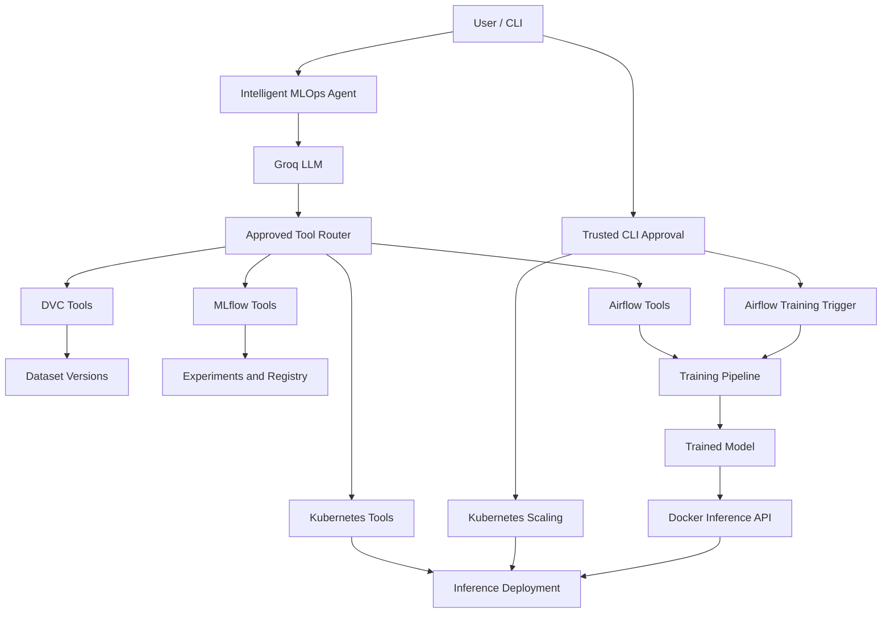

# Intelligent MLOps AI Agent

### Production-Oriented MLOps Automation with DVC, MLflow, Apache Airflow, Kubernetes, Groq AI and GitHub Actions

This project implements an intelligent MLOps agent that connects four operational systems: **DVC, MLflow, Apache Airflow and Kubernetes**.
The agent uses a Groq-hosted large language model (LLM) to interpret natural-language questions, select approved tools, retrieve operational evidence and generate responses.
The project also includes an automated training pipeline, a containerized inference API, Kubernetes deployment, explicit approval mechanisms for state-changing operations, automated testing and continuous integration.

## 1. Project Objectives
The main objectives are to:
- Track dataset versions and provenance using DVC.
- Manage machine learning experiments and registered models using MLflow.
- Automate model training using Apache Airflow.
- Deploy an inference API using Docker and Kubernetes.
- Provide an intelligent agent for querying MLOps infrastructure.
- Prevent unauthorized infrastructure modifications.
- Support explicitly approved training and scaling operations.
- Detect and investigate failures.
- Automate testing and Docker verification using GitHub Actions.

## 2. System Architecture
The system consists of an AI orchestration layer, four MLOps tool modules and a containerized inference service.



### Agent Workflow
1. The user submits a natural-language question.
2. The LLM selects an available read-only tool.
3. The orchestrator validates the tool name and arguments.
4. The approved tool retrieves information from the relevant MLOps system.
5. The tool result is returned to the LLM as operational evidence.
6. The agent generates a response based on the retrieved information.
State-changing operations use a separate CLI workflow requiring explicit confirmation.

## 3. Technology Stack
| Component | Technology | Purpose |
|---|---|---|
| Programming language | Python 3.10 | Core application |
| AI model provider | Groq | LLM-based orchestration |
| Default LLM | openai/gpt-oss-120b | Tool selection and responses |
| Dataset management | DVC | Dataset versioning and provenance |
| Experiment tracking | MLflow | Metrics, runs and model registry |
| Workflow orchestration | Apache Airflow | Automated training |
| Inference API | FastAPI | Model serving |
| Containerization | Docker | Reproducible inference environment |
| Container orchestration | Kubernetes | Deployment and health management |
| Local Kubernetes | Kind | Development cluster |
| Testing | Pytest | Automated verification |
| CI | GitHub Actions | Automated tests and Docker checks |

## 4. Project Structure
```text
assignment-03-mlops-agent/
│
├── agent/
│   ├── main.py
│   ├── orchestrator.py
│   ├── schemas.py
│   └── tools/
│       ├── dvc_tools.py
│       ├── mlflow_tools.py
│       ├── airflow_tools.py
│       └── kubernetes_tools.py
│
├── api/
│   └── main.py
│
├── dags/
│   └── training_pipeline.py
│
├── training/
│   ├── generate_data.py
│   ├── preprocess.py
│   ├── train.py
│   ├── evaluate.py
│   ├── register_model.py
│   └── airflow_stages.py
│
├── data/
│   └── train.csv.dvc
│
├── models/
│   └── model.joblib
│
├── kubernetes/
│   ├── configmap.yaml
│   ├── deployment.yaml
│   └── service.yaml
│
├── tests/
│   ├── test_dvc_tools.py
│   ├── test_mlflow_tools.py
│   ├── test_airflow_tools.py
│   ├── test_kubernetes_tools.py
│   ├── test_orchestrator.py
│   └── test_approval_workflow.py
│
├── screenshots/
├── reports/
├── .github/workflows/ci.yaml
├── Dockerfile
├── requirements-ci.txt
├── requirements-inference.txt
├── .env.example
├── architecture.md
└── README.md
```

The repository contains source code, configurations, automated tests, deployment definitions and execution evidence.
Generated runtime files such as virtual environments, local MLflow databases and temporary pipeline outputs are excluded from version control.

## 5. Installation and Setup
### Prerequisites
The project was developed and tested on Ubuntu 22.04 with Python 3.10.
Required tools include:
- Python 3.10
- Git
- Docker
- DVC
- MLflow
- Apache Airflow
- kubectl
- Kind
- A Groq API key

### Clone the Repository
```bash
git clone https://github.com/SamiyaSaleem/MLOps_Agent_Assignment-03.git
cd MLOps_Agent_Assignment-03
```

### Create a Virtual Environment

```bash
python3 -m venv .venv

source .venv/bin/activate
```

### Install Python Dependencies
```bash
python -m pip install --upgrade pip
python -m pip install -r requirements-ci.txt
```

The CI requirements file contains dependencies required for the automated tests and core tools.
For local CLI operation, additional supporting dependencies may be required depending on the enabled services.

### Configure Environment Variables
Use `.env.example` as a reference.
Example configuration:

```env
GROQ_API_KEY=your_groq_api_key_here
GROQ_MODEL=openai/gpt-oss-120b

MLFLOW_TRACKING_URI=http://127.0.0.1:5000

AIRFLOW_API_URL=http://127.0.0.1:8080
AIRFLOW_USERNAME=your_airflow_username
AIRFLOW_PASSWORD=your_airflow_password
```

Do not commit actual credentials.
Environment variables must be loaded into the terminal before running services that require them.

## 6. DVC Integration
DVC manages dataset metadata and supports dataset version identification.
The project tracks a breast cancer classification dataset through:

```text
data/train.csv.dvc
```

Historical dataset versions include:

```text
dataset-v1
dataset-v2
```

### Available DVC Operations
The DVC module supports:
- Listing tracked datasets.
- Retrieving current dataset version information.
- Comparing dataset versions.
- Detecting tracked dataset changes.
- Generating dataset reproduction instructions.

### Example Commands
Check DVC status:

```bash
dvc status
```

Inspect available dataset tags:

```bash
git tag --list "dataset-v*"
```

Compare dataset versions:

```bash
python - <<'PY'
from agent.tools.dvc_tools import compare_dataset_versions

print(compare_dataset_versions("dataset-v1", "dataset-v2"))
PY
```

### DVC Storage Note
The original development environment uses a local DVC remote.
A fresh clone does not automatically contain the external DVC cache or remote data. To reproduce dataset contents, users must configure an accessible DVC remote containing the corresponding objects, then execute:

```bash
dvc pull
```
The DVC metadata and dataset version tags are maintained separately from the model inference artifact.

## 7. MLflow Integration
MLflow is used for experiment tracking, metric comparison and model registration.
The project includes the experiment:

```text
MLOps_Assignment_03
```

Training experiments record model metrics and information about the associated runs.
The model registry includes:

```text
BreastCancerClassifier
```

The `candidate` alias identifies the model version selected for evaluation and inference preparation.

### Start MLflow
From the project directory:

```bash
source .venv/bin/activate
```

```bash
mlflow server \
  --backend-store-uri sqlite:///mlflow.db \
  --artifacts-destination ./mlartifacts \
  --host 127.0.0.1 \
  --port 5000
```
Open the MLflow interface:

```text
http://127.0.0.1:5000
```

### MLflow Capabilities
The agent's MLflow module provides operations for:
- Listing experiments.
- Retrieving training runs.
- Inspecting run details.
- Identifying the best-performing run.
- Comparing experiments.
- Inspecting model registry information.
Experiment records and registered model versions are stored in the configured MLflow tracking backend.
A fresh environment requires the relevant training and model registration steps to recreate those records.

## 8. Apache Airflow Training Pipeline
The project implements a five-stage training DAG:

```text
mlops_training_pipeline
```

### Training Stages
| Stage | Purpose |
|---|---|
| validate_dataset | Validate dataset availability and structure |
| preprocess_data | Prepare the dataset for training |
| train_model | Train the machine learning model |
| evaluate_and_log | Evaluate performance and record MLflow information |
| model_quality_gate | Check whether model performance meets the required threshold |

### Pipeline Execution

```text
validate_dataset
       |
       v
preprocess_data
       |
       v
train_model
       |
       v
evaluate_and_log
       |
       v
model_quality_gate
```

The quality gate requires the configured model performance threshold to be satisfied before a run is considered successful.

### Starting Airflow

Airflow runs in a separate virtual environment.

The development setup uses Apache Airflow 3.2.1.

Activate the Airflow environment:

```bash
source .venv-airflow/bin/activate
```

Configure paths:

```bash
export AIRFLOW_HOME="$HOME/airflow-assignment03"

export AIRFLOW__CORE__DAGS_FOLDER="$(pwd)/dags"

export AIRFLOW__CORE__LOAD_EXAMPLES=False
```

Start the local instance:

```bash
airflow standalone
```

Open:

```text
http://127.0.0.1:8080
```

### Verify DAG Registration

```bash
airflow dags list
```

### Check DAG Import Errors

```bash
airflow dags list-import-errors
```

### View Run History

```bash
airflow dags list-runs mlops_training_pipeline
```

The project successfully demonstrated training execution through all five stages.

## 9. Docker Inference API

The trained model is exported as:

```text
models/model.joblib
```

The Docker image includes the FastAPI application and the required inference artifact.

### Build the Image

```bash
docker build -t mlops-inference:v1 .
```

### Run the Container

```bash
docker run -d \
  --name mlops-inference \
  -p 8000:8000 \
  mlops-inference:v1
```

### Available API Endpoints

| Endpoint | Method | Purpose |
|---|---|---|
| `/` | GET | Application information |
| `/health` | GET | Application liveness |
| `/ready` | GET | Model readiness |
| `/predict` | POST | Generate a classification prediction |

### Health Check

```bash
curl http://127.0.0.1:8000/health
```

Example successful response:

```json
{
  "status": "alive"
}
```

### Readiness Check

```bash
curl http://127.0.0.1:8000/ready
```

Example successful response:

```json
{
  "status": "ready",
  "model_loaded": true
}
```

The prediction endpoint expects the feature structure defined by the FastAPI request schema.

The application is an educational machine learning demonstration and must not be used for clinical diagnosis.

## 10. Kubernetes Deployment

The FastAPI inference service is deployed to Kubernetes using the manifests in:

```text
kubernetes/
```

### Deployment Features

- Two inference replicas.
- Kubernetes Deployment and Service.
- Liveness health checks.
- Readiness health checks.
- CPU and memory resource requests and limits.
- ConfigMap-based application configuration.
- Non-root container execution.

### Create a Local Kind Cluster

```bash
kind create cluster --name mlops-agent
```

If the cluster already exists, this step is unnecessary.

### Build and Load the Image

```bash
docker build -t mlops-inference:v1 .
```

```bash
kind load docker-image mlops-inference:v1 \
  --name mlops-agent
```

### Create the Namespace

```bash
kubectl create namespace mlops-agent \
  --dry-run=client -o yaml | kubectl apply -f -
```

### Apply Kubernetes Resources

```bash
kubectl apply -f kubernetes/configmap.yaml
```

```bash
kubectl apply -f kubernetes/deployment.yaml
```

```bash
kubectl apply -f kubernetes/service.yaml
```

### Verify Deployment

```bash
kubectl get deployments -n mlops-agent
```

```bash
kubectl get pods -n mlops-agent
```

Expected healthy deployment:

```text
mlops-inference   2/2
```

### Access the Inference Service

```bash
kubectl port-forward \
  -n mlops-agent \
  service/mlops-inference-service \
  8001:80
```

Then, in another terminal:

```bash
curl http://127.0.0.1:8001/health
```

```bash
curl http://127.0.0.1:8001/ready
```

The supplied manifests target the local Kind deployment. Different Kubernetes environments may require changes to image availability and deployment configuration.

## 11. Intelligent AI Agent

The AI agent provides natural-language access to MLOps operational information.

### Start the Agent

```bash
source .venv/bin/activate
```

Ensure the Groq API key is configured in the terminal.

Run interactive mode:

```bash
python -m agent.main
```

Alternatively, ask an individual question:

```bash
python -m agent.main \
  --question "Are my Kubernetes replicas healthy?"
```

### Example Questions

**DVC**

```bash
python -m agent.main --question "What is my current dataset version?"
```

**MLflow**

```bash
python -m agent.main --question "List my MLflow experiments."
```

**Airflow**

```bash
python -m agent.main --question "What is the latest training pipeline status?"
```

**Kubernetes**

```bash
python -m agent.main --question "Check the health of my Kubernetes deployment."
```

**Cross-System Analysis**

```bash
python -m agent.main --question "Review the current status of DVC, MLflow, Airflow and Kubernetes."
```

The orchestrator restricts LLM tool calls to approved read-only operations.
Tool responses are collected as evidence before the final answer is generated.

### Agent Safety Controls
The orchestration layer includes:
- Explicit tool allowlisting.
- Tool argument validation.
- Restricted tool execution.
- Tool-call and interaction-round limits.
- Error handling.
- Protection against unauthorized tool access.
- Instructions to treat tool output as untrusted data.

The agent does not directly expose state-changing tools through its LLM tool registry.

## 12. Explicit Approval Workflow
The project separates read-only AI queries from infrastructure modifications.
State-changing actions are available through trusted CLI commands.

### Kubernetes Scaling

Request scaling:

```bash
python -m agent.main --scale-replicas 3
```

The CLI requires the user to type:

```text
CONFIRM SCALE 3
```

Without the exact confirmation phrase, scaling is rejected.

After approval, the Kubernetes scaling tool is invoked.

Verify deployment readiness:

```bash
kubectl rollout status \
  deployment/mlops-inference \
  -n mlops-agent
```

### Restore Two Replicas

```bash
python -m agent.main --scale-replicas 2
```

Confirmation:

```text
CONFIRM SCALE 2
```

### Airflow Training Trigger

Request a new training run:

```bash
python -m agent.main --trigger-training
```

Confirmation:

```text
CONFIRM TRAINING
```

After approval, the CLI triggers the configured Airflow DAG.

A successful trigger response confirms that Airflow accepted the request. Final pipeline completion must be verified separately.

### Security Boundary

The current implementation is designed for a trusted local CLI demonstration.

It prevents the LLM from directly invoking privileged operations and requires a separate confirmation step before state changes.

It does not implement enterprise-level identity management, multi-user authorization or centralized audit logging.

## 13. Automated Testing

Automated testing is implemented using Pytest.

### Run All Tests

```bash
python -m pytest tests/ -q
```

Verified local result:

```text
59 passed
```

### Test Coverage by Module

| Module | Number of Tests |
|---|---:|
| DVC | 9 |
| MLflow | 9 |
| Airflow | 9 |
| Kubernetes | 14 |
| Intelligent Agent | 13 |
| Approval Workflow | 5 |
| **Total** | **59** |

The tests cover tool behavior, error handling, invalid requests, timeout scenarios, security restrictions, LLM tool invocation and approval workflows.

Mocked tests isolate external services where appropriate.

Passing unit tests do not replace live integration verification.

## 14. GitHub Actions CI

GitHub Actions automatically validates the repository on pushes and pull requests targeting `main`.

Workflow file:

```text
.github/workflows/ci.yaml
```

### CI Pipeline

```text
GitHub Push / Pull Request
          |
          v
Checkout Repository
          |
          v
Set Up Python 3.10
          |
          v
Install Dependencies
          |
          v
Verify Python Syntax
          |
          v
Run Automated Tests
          |
          v
Verify Deployment Files
          |
          v
Build Docker Image
          |
          v
Start Docker Container
          |
          v
Check Health and Readiness
```

The checkout step retrieves Git history and tags, supporting tests that inspect historical DVC dataset versions.

The workflow also builds the inference image and checks the running container's `/health` and `/ready` endpoints.

This CI workflow does not deploy Kubernetes resources or execute a live Airflow training pipeline.

## 15. Failure Detection and Recovery Demonstrations

Two failure scenarios were verified.

### Scenario 1: Airflow Training Failure

A historical Airflow training execution failed during the dataset validation stage.

The recorded diagnostic information identified a Python indentation error.

Airflow marked the validation task as failed, and dependent tasks did not execute successfully.

After the implementation was corrected, the DAG completed successfully.

This demonstrates:

- Task failure identification.
- Error inspection through Airflow logs.
- Dependency-aware pipeline behavior.
- Successful execution after correction.

### Scenario 2: Kubernetes Image Pull Failure

A temporary Pod was created with an invalid image:

```text
invalid-mlops-image:v1
```

Kubernetes reported:

```text
ErrImagePull
ImagePullBackOff
```

The Pod events identified the image pull failure.

Throughout the demonstration, the original inference deployment remained healthy with two available replicas.

The temporary failed Pod was subsequently deleted, and the original deployment was verified as healthy.

This demonstrates isolated failure injection, Kubernetes diagnostics and controlled cleanup.

The failed demonstration Pod was removed rather than repaired in place.

## 16. Execution Evidence

Selected screenshots are available in the `screenshots/` directory.

### AI Agent

| Evidence | Screenshot |
|---|---|
| DVC query | [View](screenshots/agent_dvc_query.png) |
| MLflow query | [View](screenshots/agent_mlflow_query.png) |
| Airflow query | [View](screenshots/agent_airflow_query.png) |
| Kubernetes query | [View](screenshots/agent_kubernetes_query.png) |
| Multi-tool analysis | [View](screenshots/agent_multi_tool_query.png) |
| Unauthorized action rejected | [View](screenshots/agent_unauthorized_action.png) |

### Airflow

| Evidence | Screenshot |
|---|---|
| DAG structure | [View](screenshots/airflow_dag_structure.png) |
| Successful training | [View](screenshots/airflow_training_success_verified.png) |
| Failure detection | [View](screenshots/airflow_failure_detected.png) |
| Failure logs | [View](screenshots/airflow_failure_logs.png) |
| Successful recovery | [View](screenshots/airflow_failure_recovery.png) |
| Approved training | [View](screenshots/airflow_approved_training.png) |

### Kubernetes

| Evidence | Screenshot |
|---|---|
| Two healthy replicas | [View](screenshots/kubernetes_two_replicas.png) |
| Health probes | [View](screenshots/kubernetes_health_probes.png) |
| Approved scaling | [View](screenshots/kubernetes_scaling_approved.png) |
| Rejected scaling | [View](screenshots/kubernetes_scaling_rejected.png) |
| Failure detection | [View](screenshots/kubernetes_failure_detected.png) |
| Failure diagnostics | [View](screenshots/kubernetes_failure_diagnostics.png) |
| Cleanup and recovery | [View](screenshots/kubernetes_failure_recovery.png) |

### CI and MLflow

| Evidence | Screenshot |
|---|---|
| GitHub Actions success | [View](screenshots/github_actions_ci_success.png) |
| MLflow best model | [View](screenshots/mlflow_best_model.png) |
| Model registry | [View](screenshots/mlflow_model_registry.png) |
| Dataset provenance | [View](screenshots/mlflow_dataset_provenance.png) |

Additional screenshots are available in the same directory.

## 17. Troubleshooting

### DVC Dataset Versions Cannot Be Found

Ensure the required dataset tags exist locally:

```bash
git tag --list "dataset-v*"
```

Fetch historical tags if necessary:

```bash
git fetch --tags
```

### Airflow DAG Is Missing

Check import errors:

```bash
airflow dags list-import-errors
```

Verify the DAG folder is configured correctly.

For Airflow 3, DAG decorator parameters must use their supported names, including `start_date` and `max_active_runs`.

### Airflow API Returns HTTP 401

Verify the configured username and password.

Airflow 3 API authentication uses JWT access tokens.

The Airflow client must authenticate successfully before accessing protected API endpoints.

### Kubernetes Pod Is Not Ready

Inspect Pods:

```bash
kubectl get pods -n mlops-agent
```

Inspect deployment health:

```bash
kubectl describe deployment mlops-inference -n mlops-agent
```

Inspect relevant events:

```bash
kubectl get events -n mlops-agent
```

### Docker Model File Is Missing

The inference Dockerfile expects:

```text
models/model.joblib
```

Confirm the model artifact exists before building:

```bash
ls -lh models/model.joblib
```

### Tests Fail in GitHub Actions but Pass Locally

Check whether tests depend on local files, services, Git history or version tags.

The CI workflow fetches full Git history to support dataset-version tests.

Review the failing job logs for the specific error.

## 18. Limitations and Future Improvements

The current system is a local, assignment-oriented MLOps implementation.

Future improvements include:

- External DVC object storage for reproducible dataset retrieval.
- Hosted MLflow tracking and artifact storage.
- Authentication and role-based authorization.
- Centralized action audit logs.
- Automated Kubernetes deployment in CI/CD.
- Model monitoring and drift detection.
- Additional integration and security tests.
- Improved operational dashboards.

## 19. Conclusion

This project demonstrates how an intelligent AI agent can interact with a complete MLOps workflow.

DVC provides dataset versioning, MLflow manages model experiments, Airflow automates training, and Kubernetes manages inference deployments.

The AI agent connects these systems through approved tools, allowing operational information to be retrieved using natural-language questions.

Explicit confirmation protects state-changing actions, while Pytest and GitHub Actions provide automated validation.

Failure demonstrations show how operational problems can be detected, diagnosed and addressed.

Overall, the implementation demonstrates the integration of machine learning lifecycle management, infrastructure orchestration, agentic AI, operational safety and automated software delivery.
