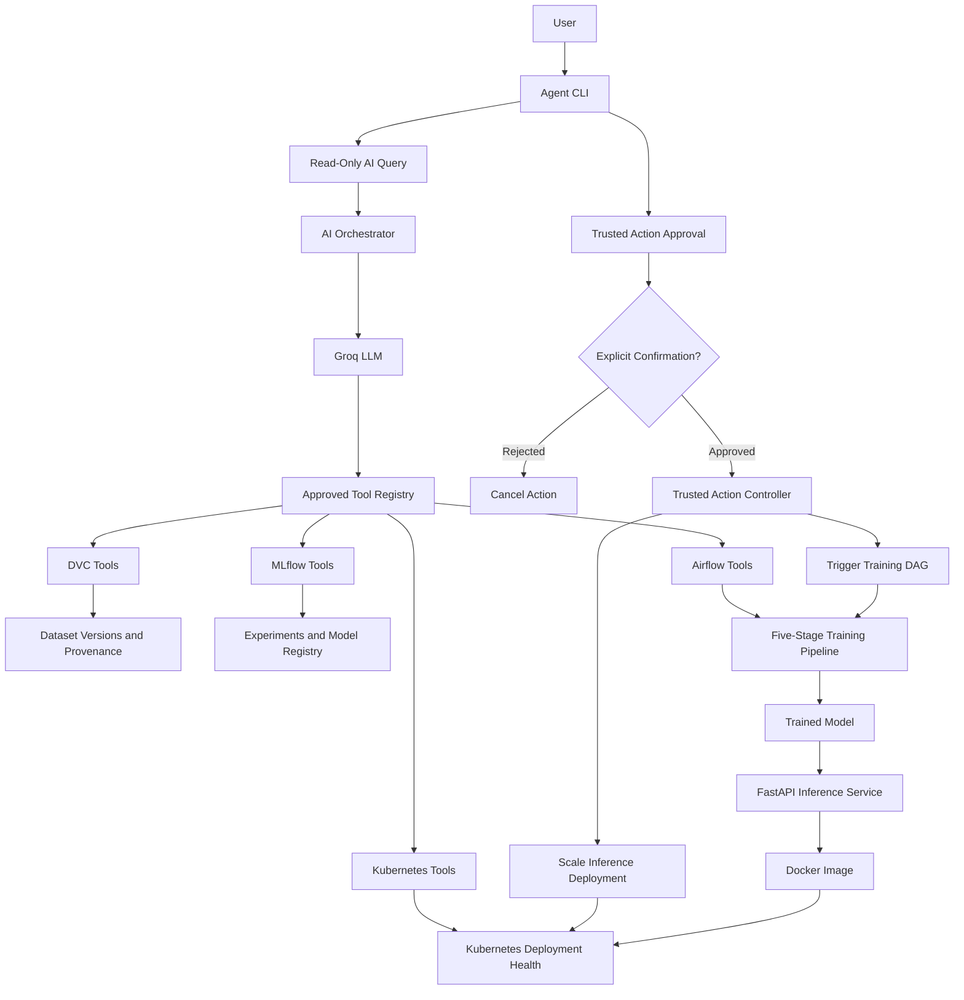

# MLOps AI Agent — System Architecture

## 1. Architecture Overview
The project implements an intelligent MLOps agent that integrates four operational systems: DVC, MLflow, Apache Airflow and Kubernetes.
The system separates natural-language operational queries from privileged infrastructure actions. The AI orchestrator supports approved read-only operations, while a trusted command-line interface handles explicitly confirmed state-changing requests.

## 2. System Architecture Diagram

## 3. Main Components
### AI Orchestration Layer
The agent is implemented in `agent/orchestrator.py`.
It interprets natural-language questions through a Groq-hosted LLM, validates requested tools against an approved registry and returns evidence-based responses.
The LLM cannot directly execute arbitrary shell commands or invoke privileged infrastructure operations.

### DVC Integration
Implemented in `agent/tools/dvc_tools.py`.
The DVC integration provides dataset discovery, version identification, provenance inspection, version comparison, change detection and reproduction instructions.
Dataset metadata is tracked in `data/train.csv.dvc`.

### MLflow Integration
Implemented in `agent/tools/mlflow_tools.py`.
MLflow supports experiment discovery, training-run inspection, metric comparison and registered-model information.
The project uses the `MLOps_Assignment_03` experiment and the `BreastCancerClassifier` registered model.

### Apache Airflow Integration
Implemented through `dags/training_pipeline.py` and `agent/tools/airflow_tools.py`.
The DAG `mlops_training_pipeline` contains five sequential stages:

1. `validate_dataset`
2. `preprocess_data`
3. `train_model`
4. `evaluate_and_log`
5. `model_quality_gate`
The pipeline performs dataset validation, preprocessing, training, evaluation and quality verification.

### Kubernetes Integration
Implemented in `agent/tools/kubernetes_tools.py` and the `kubernetes/` manifests.
The inference service runs as a Kubernetes Deployment with two replicas.
Kubernetes manages container scheduling, liveness checks, readiness checks, resource limits and Service endpoints.

### FastAPI Inference Service
Implemented in `api/main.py`.
The inference API loads the trained model from `models/model.joblib` and provides:

- `GET /`
- `GET /health`
- `GET /ready`
- `POST /predict`

The application is packaged using Docker.

## 4. Read-Only Agent Execution
The operational query workflow is:
1. The user submits a question.
2. The orchestrator sends the question to the LLM.
3. The LLM requests an approved tool.
4. The orchestrator validates the tool name and arguments.
5. The selected tool queries the relevant MLOps system.
6. The tool result is returned to the LLM.
7. The agent generates an evidence-based answer.
Tool execution is restricted to an explicit allowlist.

## 5. Trusted Approval Workflow
State-changing operations are implemented separately from the LLM tool registry.

### Kubernetes Scaling
The user requests a replica count through the CLI.
The CLI displays the requested operation and requires an exact confirmation phrase.
After confirmation, the approved Kubernetes scaling function is called.
Deployment health can then be inspected to verify the outcome.

### Airflow Training Trigger
The user requests training through the CLI.
The CLI requires explicit confirmation before invoking the approved Airflow DAG trigger.
The returned run ID identifies the requested execution.
Pipeline completion is verified separately using Airflow run status.

## 6. CI Architecture
The GitHub Actions workflow is defined in `.github/workflows/ci.yaml`.
It performs:
1. Git checkout with history and tags.
2. Python environment setup.
3. Dependency installation.
4. Python syntax verification.
5. Automated Pytest execution.
6. Deployment-file verification.
7. Docker image building.
8. Container startup.
9. Health and readiness checks.
The verified local test suite contains 59 tests.

## 7. Failure Handling
Two failure demonstrations were performed.
**Airflow:** A training run failed during dataset validation. Airflow recorded the failure and prevented dependent stages from completing. After correcting the implementation, a subsequent run completed successfully.

**Kubernetes:** A temporary Pod was created using an invalid container image. Kubernetes reported `ErrImagePull` and `ImagePullBackOff`. The original inference deployment remained healthy. The temporary Pod was subsequently removed.

## 8. Architectural Limitations
The implementation is designed for a local academic demonstration.
The DVC remote, MLflow backend and Airflow runtime are configured locally.
The trusted CLI provides explicit confirmation but does not implement multi-user authentication or role-based access control.
The GitHub Actions pipeline verifies tests and Docker inference behavior, but does not automatically deploy the application to Kubernetes.

## 9. Conclusion
The architecture demonstrates how an intelligent AI agent can integrate dataset management, experiment tracking, workflow orchestration and containerized deployment.
The separation between read-only AI operations and explicitly approved infrastructure actions provides an important operational safety boundary.
Automated testing, continuous integration, health checks and controlled failure demonstrations support the reliability and maintainability of the implementation.
