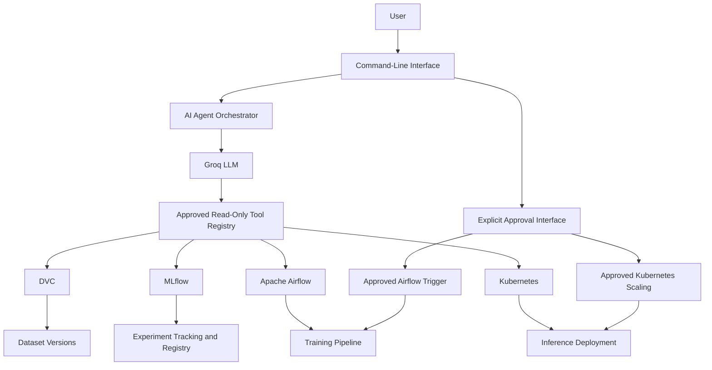

# Technical Report: Production-Ready MLOps AI Agent

**Course:** MLOps  
**Assignment:** Assignment 03 — Intelligent MLOps AI Agent  
**Student:** Samiya Saleem  
**Development Environment:** Ubuntu 22.04, Python 3.10  
**Repository:** https://github.com/SamiyaSaleem/MLOps_Agent_Assignment-03  
**Report Date:** November 2026

---

# 1. Executive Summary
This project implements an intelligent MLOps AI agent integrating four major machine learning operations technologies: DVC, MLflow, Apache Airflow, and Kubernetes.
The objective is to demonstrate how an AI agent can retrieve operational information from different MLOps components, perform cross-system analysis, and support controlled infrastructure management.
The application uses a Groq-hosted large language model (LLM) for natural-language interaction and tool selection. The LLM can access approved read-only operations, while state-changing operations require explicit user confirmation through a separate command-line interface.
The implementation includes a five-stage automated training pipeline, experiment tracking, dataset version management, containerized model inference, Kubernetes deployment, automated testing, and GitHub Actions continuous integration.
The completed implementation was evaluated through 59 automated tests, successful Airflow training runs, Kubernetes deployment verification, Docker health checks, and controlled failure demonstrations.
The system is implemented and verified in a local development environment. Although the architecture incorporates production-oriented practices, it is not presented as a fully managed production deployment.

---

# 2. Introduction
Machine learning systems require continuous coordination between datasets, training experiments, workflows, model artifacts, and deployment infrastructure.
Managing these components independently introduces operational challenges.
For example, an engineer investigating a prediction service may need to check the current dataset version, identify the best model, inspect the latest training execution, and confirm whether the deployment is healthy.
Traditionally, these operations require manual interaction with multiple systems.
The proposed intelligent MLOps agent provides a common interface through which users can request operational information using natural language.
The agent connects the following technologies:

- **DVC:** Dataset versioning and provenance.
- **MLflow:** Experiment tracking and model registry.
- **Apache Airflow:** Automated training orchestration.
- **Kubernetes:** Containerized inference deployment and operational health.
- **Groq LLM:** Natural-language understanding and tool selection.

The project also demonstrates operational safety by separating informational requests from actions that modify infrastructure.

---

# 3. Project Objectives
The project was developed to achieve the following objectives:
1. Implement dataset tracking and version comparison using DVC.
2. Integrate MLflow for experiment management, metric inspection, and model registration.
3. Implement an Apache Airflow training pipeline with validation, preprocessing, training, evaluation, and quality verification.
4. Deploy a machine learning inference API using Docker and Kubernetes.
5. Build an intelligent LLM-based agent capable of interacting with multiple MLOps tools.
6. Introduce explicit user confirmation for infrastructure-changing operations.
7. Implement error handling, tool restrictions, and safe operational responses.
8. Develop automated tests covering normal execution, invalid inputs, and failure scenarios.
9. Configure GitHub Actions to automatically test the application and verify Docker inference.
10. Demonstrate failure detection, diagnosis, and controlled recovery.

---

# 4. System Architecture
The architecture consists of three major layers:
**Layer 1: User Interaction and AI Orchestration**

The user interacts with the system through a Python command-line interface.

The agent receives natural-language questions and communicates with the Groq-hosted LLM.

The LLM selects from an explicitly approved set of read-only tools.

**Layer 2: MLOps Tool Integration**

The tool layer connects the agent to DVC, MLflow, Airflow, and Kubernetes.

Each module provides functions responsible for retrieving structured operational information.

**Layer 3: Machine Learning Execution and Deployment**

The execution layer contains the dataset, training scripts, registered models, Airflow pipeline, Docker image, and Kubernetes inference service.

## 4.1 Architecture Diagram



The detailed architecture is also documented in `architecture.md`.

## 4.2 Architectural Design Decisions

The implementation uses separate modules for each external system.

This approach improves maintainability, allows independent testing, and prevents the LLM from directly accessing unrestricted infrastructure commands.

The trusted approval interface is intentionally separated from the LLM tool registry.

Consequently, the model cannot directly invoke scaling or training operations through ordinary tool calls.

---

# 5. DVC Implementation

## 5.1 Dataset Management

DVC is used to manage the training dataset and maintain historical version information.

The project uses a breast cancer classification dataset stored at:

`data/train.csv`

Its DVC metadata is maintained in:

`data/train.csv.dvc`

Two historical dataset versions were created:

- `dataset-v1`
- `dataset-v2`

The latest demonstrated dataset contains 400 records and 31 columns, including the target column.

Dataset versions are identified through Git tags and DVC content hashes.

## 5.2 Implemented Tools

The DVC integration is implemented in:

`agent/tools/dvc_tools.py`

The module provides functionality for:

- Listing tracked datasets.
- Retrieving current dataset provenance.
- Comparing historical dataset versions.
- Detecting changes to tracked data.
- Producing dataset reproduction instructions.
- Validating dataset version identifiers.

## 5.3 Dataset Provenance

The system retrieves information including:

- Git commit identifier.
- DVC content hash.
- Dataset file size.
- Matching historical dataset tags.
- Working-directory status.

The implementation distinguishes the current Git HEAD from the historical commit where a dataset version was introduced.

This distinction is important because application code may change without modifying the tracked dataset.

## 5.4 DVC Testing Results

The DVC module passed nine automated tests.

Testing covered valid dataset operations, invalid versions, unavailable commands, command timeouts, and invalid JSON responses.

## 5.5 Limitations

The development environment uses a local DVC remote.

Although DVC metadata and Git tags are maintained in the repository, the external DVC object storage is not automatically reproduced when another user clones the project.

Access to the corresponding DVC remote is required to restore historical dataset contents.

**Evidence:** `screenshots/agent_dvc_query.png`

---

# 6. MLflow Implementation

## 6.1 Experiment Tracking

MLflow manages machine learning experiments, training runs, and model information.

The configured experiment is:

`MLOps_Assignment_03`

During implementation, Logistic Regression configurations were evaluated and tracked using MLflow.

The recorded metrics included:

- Accuracy
- Precision
- Recall
- F1-score

The demonstrated training runs achieved an accuracy and F1-score of 1.0 on the evaluation setup used during development.

These results describe the specific experimental evaluation and do not establish generalization to other datasets or real-world medical settings.

## 6.2 Model Registry

The trained classifier was registered under:

`BreastCancerClassifier`

A registered model version was assigned the alias:

`candidate`

The registered model was subsequently exported as a serialized scikit-learn pipeline for inference.

The exported artifact is stored at:

`models/model.joblib`

## 6.3 MLflow Tool Integration

The MLflow tools are implemented in:

`agent/tools/mlflow_tools.py`

Implemented capabilities include:

- Listing experiments.
- Retrieving training runs.
- Inspecting individual run details.
- Identifying the best run.
- Comparing experiments.
- Inspecting model registry information.

## 6.4 Testing Results

Nine MLflow automated tests passed successfully.

The tests validate experiment-related functionality and error-handling behavior.

The actual MLflow interface was also used to inspect recorded runs, metrics, and model registration.

## 6.5 Evidence

- `screenshots/mlflow_best_model.png`
- `screenshots/mlflow_experiment_comparison.png`
- `screenshots/mlflow_model_registry.png`
- `screenshots/mlflow_dataset_provenance.png`

---

# 7. Apache Airflow Implementation

## 7.1 Training Pipeline

Apache Airflow 3.2.1 is used to orchestrate the machine learning training process.

The DAG is defined in:

`dags/training_pipeline.py`

The configured DAG ID is:

`mlops_training_pipeline`

## 7.2 Pipeline Stages

The pipeline consists of five sequential tasks.

| Task | Description |
|---|---|
| `validate_dataset` | Checks dataset availability and validity |
| `preprocess_data` | Performs dataset preprocessing |
| `train_model` | Trains the machine learning model |
| `evaluate_and_log` | Evaluates performance and records experiment information |
| `model_quality_gate` | Verifies whether performance meets the required threshold |

The tasks execute in the following sequence:

```text
validate_dataset
       |
       v
preprocess_data
       |
       v
train_model
       |
       v
evaluate_and_log
       |
       v
model_quality_gate
```

The quality gate checks the configured F1-score threshold of 0.90.

## 7.3 Airflow Tool Integration

The Airflow integration is implemented in:

`agent/tools/airflow_tools.py`

The module supports:

- DAG discovery.
- Latest pipeline status retrieval.
- Task status inspection.
- Failed-task identification.
- Failure diagnostics.
- Approved training pipeline triggering.

## 7.4 Successful Pipeline Execution

A complete training run was triggered through the explicit approval interface.

**Verified DAG ID:** `mlops_training_pipeline`

**Verified run ID:**

`manual__2026-11-13T20:21:11.593548+00:00`

The run started at approximately 20:21:12 UTC on November 13, 2026, and completed successfully at approximately 20:21:35 UTC.

The execution duration was approximately 23 seconds.

The Airflow interface confirmed successful execution of all five pipeline stages.

## 7.5 Testing

Nine Airflow tool tests passed successfully.

Additional approval-workflow tests verified that training cannot be triggered through the CLI unless the required confirmation is provided.

## 7.6 Evidence

- `screenshots/airflow_dag_structure.png`
- `screenshots/airflow_successful_run.png`
- `screenshots/airflow_approved_training.png`
- `screenshots/airflow_training_success_verified.png`

---

# 8. Kubernetes and Docker Implementation

## 8.1 Inference Application

The inference application is developed using FastAPI.

The implementation is located in:

`api/main.py`

It loads a serialized scikit-learn pipeline from:

`models/model.joblib`

The application exposes the following endpoints:

| Method | Endpoint | Purpose |
|---|---|---|
| GET | `/` | Application information |
| GET | `/health` | Liveness verification |
| GET | `/ready` | Model readiness verification |
| POST | `/predict` | Model inference |

## 8.2 Docker Packaging

The application is packaged using a Docker image based on Python 3.10.

The Dockerfile installs the required inference dependencies, copies the FastAPI application and model artifact, and executes the application using Uvicorn.

The container runs as a non-root user.

The model artifact was committed to the repository to support reproducible Docker builds.

## 8.3 Kubernetes Deployment

The application was deployed using a local Kind Kubernetes cluster.

**Cluster:** `mlops-agent`

**Namespace:** `mlops-agent`

**Deployment:** `mlops-inference`

The deployment maintains two replicas.

Its configuration includes:

- Liveness probes.
- Readiness probes.
- CPU and memory resource requests.
- CPU and memory limits.
- ConfigMap-based configuration.
- Kubernetes Service networking.

## 8.4 Verification Results

The following deployment state was verified:

```text
NAME              READY   UP-TO-DATE   AVAILABLE
mlops-inference   2/2     2            2
```

The Docker container also returned:

**Health endpoint:**

```json
{
  "status": "alive"
}
```

**Readiness endpoint:**

```json
{
  "status": "ready",
  "model_loaded": true
}
```

Both endpoints returned HTTP 200 during verification.

## 8.5 Testing Results

Fourteen Kubernetes tool tests passed successfully.

Testing included operational health queries, resource inspection, validation of scaling requests, and failure handling.

## 8.6 Evidence

- `screenshots/kubernetes_cluster_ready.png`
- `screenshots/kubernetes_two_replicas.png`
- `screenshots/kubernetes_health_probes.png`
- `screenshots/kubernetes_inference_success.png`
- `screenshots/docker_inference_running.png`

---

# 9. Intelligent AI Agent Implementation

## 9.1 Agent Design

The intelligent agent is implemented through:

- `agent/main.py`
- `agent/orchestrator.py`
- `agent/schemas.py`

The orchestrator uses a Groq-hosted language model.

The configured default model is:

`openai/gpt-oss-120b`

The model interprets user requests and selects from approved read-only tools.

## 9.2 Available Read-Only Tools

The LLM-facing registry exposes eight operations.

| System | Tool |
|---|---|
| DVC | `list_datasets` |
| DVC | `get_current_dataset_version` |
| MLflow | `list_experiments` |
| Airflow | `list_dags` |
| Airflow | `get_latest_pipeline_status` |
| Kubernetes | `get_deployment_health` |
| Kubernetes | `get_service_endpoints` |
| Kubernetes | `list_kubernetes_resources` |

The other MLOps modules also contain additional helper and operational functions, but these are not automatically exposed to the LLM.

## 9.3 Agent Execution Flow

The execution process is:

1. Receive the user question.
2. Send the question and system instructions to the Groq model.
3. Receive an LLM tool-call request.
4. Validate the requested tool against the approved registry.
5. Validate the tool arguments.
6. Execute the approved function.
7. Capture the result and execution status.
8. Return the tool result to the LLM.
9. Generate the final user-facing response.

The agent maintains a record of tools used and associated execution evidence.

## 9.4 Cross-System Operational Review

A combined operational question was tested across all four MLOps systems.

The agent successfully selected and invoked eight approved tools during a multi-tool interaction.

This demonstrated that the orchestrator could collect evidence from multiple independent services before producing a consolidated operational response.

## 9.5 Error Handling

The orchestrator includes:

- Invalid-question validation.
- Missing API key detection.
- Tool allowlist enforcement.
- Tool argument validation.
- Unsupported tool rejection.
- Tool execution error handling.
- Maximum tool-round limits.
- Maximum tool-call limits.
- Exception handling for LLM requests.

The system prompt also directs the model to treat tool responses as untrusted data and avoid unsupported operational claims.

## 9.6 Agent Testing Results

Thirteen orchestrator tests passed.

These tests included mocked LLM tool selection, unauthorized tool rejection, invalid inputs, and tool failure behavior.

## 9.7 Evidence

- `screenshots/agent_dvc_query.png`
- `screenshots/agent_mlflow_query.png`
- `screenshots/agent_airflow_query.png`
- `screenshots/agent_kubernetes_query.png`
- `screenshots/agent_multi_tool_query.png`
- `screenshots/agent_security_tests.png`

---

# 10. Security and Explicit Approval

## 10.1 Security Requirement

A major security consideration in agentic systems is preventing the LLM from performing unauthorized changes.

For example, an operational assistant should not automatically scale deployments or trigger training simply because a user includes those instructions in an ordinary question.

The implementation addresses this problem by separating read-only LLM tools from state-changing CLI operations.

## 10.2 Kubernetes Scaling Approval

The user requests scaling through:

```bash
python -m agent.main --scale-replicas 3
```

The CLI presents the intended action and requires the exact phrase:

```text
CONFIRM SCALE 3
```

A rejected confirmation results in no scaling action.

During live verification:

1. A scaling request was rejected.
2. The deployment remained at two replicas.
3. A second request was explicitly approved.
4. Kubernetes scaled the deployment to three replicas.
5. The deployment reached a healthy 3/3 state.
6. An approved operation restored the original two replicas.
7. Kubernetes returned to a healthy 2/2 state.

## 10.3 Airflow Training Approval

Training is requested through:

```bash
python -m agent.main --trigger-training
```

The user must enter:

```text
CONFIRM TRAINING
```

A rejected request does not trigger the pipeline.

An approved request invokes the configured training DAG.

The resulting run ID is returned, and execution status can be independently verified through Airflow.

## 10.4 Security Verification

Five automated approval-workflow tests passed.

They covered:

- Rejected Kubernetes scaling.
- Approved Kubernetes scaling.
- Invalid replica counts.
- Rejected Airflow training.
- Approved Airflow training.

## 10.5 Security Limitations

The confirmation workflow is designed for a trusted local CLI environment.

It does not implement multi-user authentication, centralized approval records, or role-based authorization.

For deployment in an organization, additional authentication, authorization, and audit controls would be necessary.

## 10.6 Evidence

- `screenshots/agent_unauthorized_action.png`
- `screenshots/kubernetes_scaling_rejected.png`
- `screenshots/kubernetes_scaling_approved.png`
- `screenshots/airflow_trigger_rejected.png`
- `screenshots/airflow_approved_training.png`

---

# 11. Automated Testing

## 11.1 Testing Strategy

Pytest is used for automated verification.

The tests cover normal operation, invalid inputs, error handling, tool restrictions, and approval workflows.

Mocking is used where appropriate to isolate external systems.

This allows automated tests to run in GitHub Actions without requiring a live Airflow server, MLflow service, or Kubernetes cluster.

## 11.2 Test Results

| Module | Tests Passed |
|---|---:|
| DVC tools | 9 |
| MLflow tools | 9 |
| Airflow tools | 9 |
| Kubernetes tools | 14 |
| Intelligent agent | 13 |
| Approval workflow | 5 |
| **Total** | **59** |

The complete local test suite was executed using:

```bash
python -m pytest tests/ -q
```

**Verified result:**

```text
59 passed
```

## 11.3 Interpretation

The passing tests demonstrate that the implemented modules behave as expected for the covered scenarios.

However, passing automated tests does not prove the absence of all defects.

Live operational verification was therefore also performed for the Airflow pipeline, Kubernetes deployment, Docker container, and AI-agent demonstrations.

---

# 12. GitHub Actions CI

## 12.1 CI Configuration

GitHub Actions provides automated validation of repository changes.

The workflow is defined in:

`.github/workflows/ci.yaml`

It runs when changes are pushed to `main` or pull requests target the main branch.

## 12.2 CI Stages

The workflow performs:

1. Repository checkout.
2. Python 3.10 environment setup.
3. Dependency installation.
4. Python syntax verification.
5. Automated Pytest execution.
6. Kubernetes and Docker configuration-file checks.
7. Docker image building.
8. Container startup.
9. HTTP health and readiness checks.
10. Container cleanup.

## 12.3 CI Troubleshooting

During development, the CI workflow initially reported two failing DVC tests.

Investigation identified the requirement for historical Git tags and repository history.

The checkout configuration was updated to fetch the complete history and tags.

After correction, the GitHub Actions workflow passed.

This demonstrated the importance of testing in a clean environment rather than relying exclusively on the local development machine.

## 12.4 Docker Verification in CI

The CI workflow also builds the inference image and starts a temporary container.

It verifies that:

- The container starts successfully.
- The application responds to `/health`.
- The application responds to `/ready`.
- The model is available for inference.

The workflow cleans up the temporary container after execution.

## 12.5 Evidence

` screenshots/github_actions_ci_success.png `

The workflow run history is available through the repository's GitHub Actions page.

---

# 13. Failure Injection and Recovery Analysis

Two failure scenarios were demonstrated to evaluate operational diagnostics and recovery procedures.

## 13.1 Failure Scenario A — Airflow Training Failure

### Failure Description

A historical execution of `mlops_training_pipeline` failed during the dataset validation stage.

The affected task was:

`validate_dataset`

The recorded error was:

```text
IndentationError:
expected an indented block after 'if' statement
```

The error originated in:

`training/airflow_stages.py`

### System Behavior

Airflow detected the failure and marked the validation task as failed.

Because the pipeline stages were configured with dependencies, the downstream tasks did not complete successfully.

This prevented the remainder of the training workflow from proceeding after the validation failure.

### Diagnosis

The task logs provided the exception type and source location.

The implementation was corrected, and the training pipeline was executed again.

### Recovery Verification

A subsequent execution on November 9, 2026, completed successfully.

Another explicitly approved execution on November 13, 2026, also completed successfully.

### Lessons Learned

The demonstration showed the importance of:

- Capturing task logs.
- Identifying the failing pipeline stage.
- Preserving task dependencies.
- Correcting implementation errors.
- Verifying recovery through a successful rerun.

### Evidence

- `screenshots/airflow_failure_detected.png`
- `screenshots/airflow_failure_logs.png`
- `screenshots/airflow_failure_recovery.png`

---

## 13.2 Failure Scenario B — Kubernetes Image Pull Failure

### Failure Description

A temporary Pod named:

`mlops-failure-demo`

was created using an intentionally invalid image:

`invalid-mlops-image:v1`

The image could not be retrieved from the container registry.

### System Behavior

Kubernetes reported:

```text
ErrImagePull
ImagePullBackOff
```

The Pod remained unavailable because the image could not be downloaded.

### Diagnosis

The `kubectl describe pod` command provided events showing that Kubernetes had attempted to pull the image.

The event log identified the unavailable image or denied image access as the reason for failure.

### Isolation Verification

Throughout the demonstration, the original inference deployment remained healthy:

```text
mlops-inference   2/2
```

Both inference Pods continued running.

### Cleanup and Recovery

The temporary failed Pod was deleted after the diagnostic evidence was collected.

The original inference deployment was then checked again.

It remained healthy with two replicas.

This demonstrates failure isolation, diagnostic inspection, and controlled cleanup.

The failed temporary Pod was removed rather than repaired in place.

### Lessons Learned

The demonstration highlighted:

- Kubernetes image pull diagnostics.
- The difference between scheduling and container readiness.
- The usefulness of Pod events.
- Failure isolation between workloads.
- The importance of verifying the healthy deployment after cleanup.

### Evidence

- `screenshots/kubernetes_failure_detected.png`
- `screenshots/kubernetes_failure_diagnostics.png`
- `screenshots/kubernetes_failure_recovery.png`

---

# 14. Consolidated Results

The following table summarizes the verified outcomes.

| Requirement | Verified Result |
|---|---|
| DVC dataset tracking | Dataset versions available |
| MLflow experiment tracking | Experiment and runs created |
| MLflow model registration | Registered classifier with candidate alias |
| Airflow orchestration | Five-stage DAG successfully executed |
| Docker inference | Image built and container started |
| API liveness | HTTP 200 |
| API readiness | HTTP 200; model loaded |
| Kubernetes deployment | Two healthy replicas |
| AI agent queries | Successful operational tool calls |
| Cross-system analysis | Eight approved tools used in demonstration |
| Unauthorized actions | Rejected |
| Approved Kubernetes scaling | Successfully scaled and restored |
| Approved Airflow training | Triggered and completed successfully |
| Automated testing | 59 tests passed |
| GitHub Actions | Successful CI executions |
| Airflow failure | Detected, diagnosed, followed by successful rerun |
| Kubernetes failure | Detected, diagnosed, isolated, and cleaned up |

These results indicate that the system successfully demonstrates the major components of an integrated MLOps workflow.

---

# 15. Challenges Encountered

Several technical challenges were encountered during implementation.

## 15.1 Cross-System Integration

DVC, MLflow, Airflow, and Kubernetes expose different interfaces and return different data structures.

Separate tool modules were developed to handle these differences.

## 15.2 LLM Tool Calling

The agent required reliable tool selection, consistent result handling, and controls against unsupported actions.

An explicit tool allowlist and argument validation were used to restrict execution.

## 15.3 Airflow Configuration

Airflow DAG parsing required framework-supported parameter names.

Incorrect parameter names, including `starting_date` and `maximum_active_runs`, caused import errors during refactoring.

These were corrected to `start_date` and `max_active_runs`.

## 15.4 Airflow API Authentication

Airflow 3 uses token-based authentication for API requests.

Authentication initially failed because the supplied credentials were not accepted.

After correcting the credentials and verifying the JWT flow, the agent successfully retrieved DAG information and triggered an approved training run.

## 15.5 CI Environment Differences

Historical dataset version tests initially failed in the GitHub Actions environment.

Fetching Git history and tags resolved the missing-history problem.

## 15.6 Docker Model Packaging

The inference Dockerfile required the trained `model.joblib` artifact.

Initially, this file was not tracked in Git.

The verified model artifact was added to the repository, allowing the Docker image to build with the required model file.

---

# 16. Limitations

Although the implementation demonstrates production-oriented MLOps practices, several limitations remain.

**Local infrastructure:** Airflow, MLflow, and Kubernetes were demonstrated primarily in a local environment.

**DVC storage:** The local DVC remote is not automatically available to external users.

**Model evaluation:** The reported evaluation metrics are specific to the development dataset and evaluation procedure.

**Security:** The trusted CLI uses explicit confirmation but does not provide enterprise identity management or multi-user authorization.

**Observability:** The system provides operational queries and diagnostics but does not implement a complete centralized monitoring platform.

**Continuous deployment:** GitHub Actions validates tests and Docker behavior but does not automatically deploy changes to Kubernetes.

These limitations identify potential improvements for a future production deployment.

---

# 17. Future Improvements

The system could be extended through:

1. Cloud-hosted DVC artifact storage.
2. Remote MLflow tracking and model registry services.
3. Managed Apache Airflow infrastructure.
4. Kubernetes deployment automation.
5. Identity-based access control.
6. Centralized approval and audit logging.
7. Model monitoring and drift detection.
8. Additional integration tests.
9. Production-grade secret management.
10. Operational dashboards and alerting.

These improvements would strengthen the system's reliability, security, and maintainability in larger deployment environments.

---

# 18. Conclusion

This assignment demonstrates the integration of four important MLOps technologies into a unified intelligent agent system.

DVC manages dataset versions and provenance, MLflow provides experiment tracking and model registration, Airflow orchestrates training, and Kubernetes hosts the containerized inference application.

The Groq-based agent enables users to retrieve operational information using natural-language questions.

A separate trusted approval interface restricts state-changing actions until explicit user confirmation is provided.

The application was evaluated through 59 automated tests, successful GitHub Actions workflows, Docker health checks, Kubernetes deployment verification, approved scaling operations, successful training executions, and controlled failure demonstrations.

The results show that the implementation achieves its primary academic objectives and demonstrates practical understanding of MLOps automation, tool orchestration, operational safety, CI, containerization, and failure handling.

The architecture also provides a foundation for future improvements involving managed infrastructure, stronger access controls, automated deployment, and continuous model monitoring.

---

# 19. Supporting Evidence

The following repository locations contain the supporting implementation and evidence.

| Category | Location |
|---|---|
| AI orchestration | `agent/orchestrator.py` |
| CLI and approvals | `agent/main.py` |
| DVC integration | `agent/tools/dvc_tools.py` |
| MLflow integration | `agent/tools/mlflow_tools.py` |
| Airflow integration | `agent/tools/airflow_tools.py` |
| Kubernetes integration | `agent/tools/kubernetes_tools.py` |
| Airflow DAG | `dags/training_pipeline.py` |
| Inference API | `api/main.py` |
| Kubernetes manifests | `kubernetes/` |
| Automated tests | `tests/` |
| CI workflow | `.github/workflows/ci.yaml` |
| Architecture documentation | `architecture.md` |
| Execution screenshots | `screenshots/` |
| Project setup and usage | `README.md` |

**GitHub Repository:**
https://github.com/SamiyaSaleem/MLOps_Agent_Assignment-03

**End of Technical Report**
